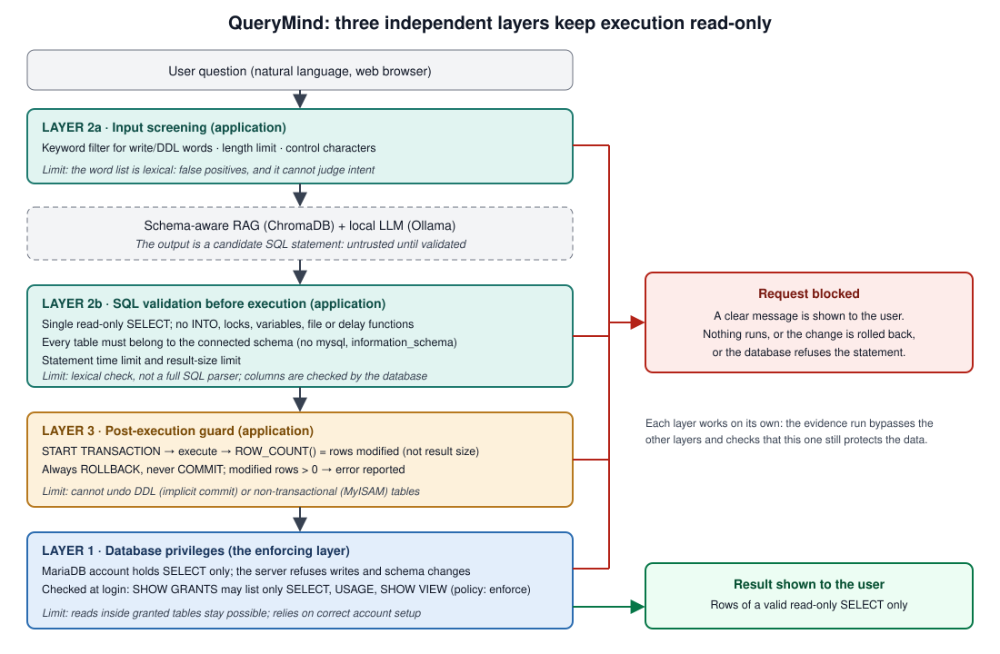

# QueryMind: three layers that keep execution read-only

 (vector PDF: `security_layers.pdf`)

All three layers live in [`security.py`](../security.py) and are wired into [`app.py`](../app.py). Each is designed to
work **on its own**; the evidence run switches the other layers off in turn and checks that the remaining one still
protects the data.

| Layer | Where | What it does |
|---|---|---|
| **1 Database-level** | `check_select_only_account` (called at login) | Runs `SHOW GRANTS` for the connected account. Only `SELECT`, `USAGE` and `SHOW VIEW` are accepted; anything else, `GRANT OPTION`, or a role grant fails. Policy `QUERYMIND_PRIVILEGE_POLICY`: `enforce` (default, login refused), `warn`, `off`. |
| **2 Application-level** | `validate_question`, `llm_engine.is_dangerous_query`, `query_executor.extract_sql`, `validate_sql` | Screens the question (keyword filter, length, control characters) and validates the generated SQL before it runs: one statement, SELECT/WITH only, no `INTO`, locking reads, variables, executable comments, file/delay/identity functions, and every table must belong to the connected schema (other schemas such as `mysql` and `information_schema` are refused). |
| **3 Post-execution** | `execute_guarded` / `run_query_guarded` | Runs every statement inside `START TRANSACTION`, reads the server's **modified-row count** with `ROW_COUNT()`, always ends with `ROLLBACK` (never `COMMIT`), and reports an error if more than zero rows were modified. Also applies a statement time limit (default 60 s) and a result-size limit (default 50,000 rows). |

## What each layer guarantees, and what it does not

**Layer 1.** *Guarantee:* a verified SELECT-only account cannot change data or schema; the server refuses every write,
DDL, `GRANT`, `CREATE USER` and `SELECT ... INTO OUTFILE`. This is the layer that actually enforces read-only access.
*Limits:* it does not stop reads inside the granted tables (including inference from what the model is shown), delay
or resource-exhaustion queries (`SLEEP` runs under a SELECT-only account), or a badly configured account (the check
inspects the grants it can see; roles are treated as unverifiable and refused).

**Layer 2.** *Guarantee:* a statement that passes is a single read-only SELECT over known tables with none of the
constructs listed above; stacked statements, `UPDATE`/`DROP`-style statements, `mysql.user`, `information_schema`,
`LOAD_FILE`, `SLEEP`, `INTO OUTFILE` and executable comments (`/*!...*/`) are rejected before they reach the database.
*Limits:* the validator is lexical, not a full SQL parser. It does not check columns (the database does), cannot judge
intent (a harmless `OR 1=1` read is accepted), may reject legitimate SQL that uses a reserved word unquoted (such as
a column named `set`; quote it with backticks), and assumes the default string-escaping mode (`NO_BACKSLASH_ESCAPES`
is not handled). The keyword filter on the *question* has known false positives (words like "set" or "update" in an
innocent sentence).

**Layer 3.** *Guarantee:* for transactional (InnoDB) tables, an `INSERT`/`UPDATE`/`DELETE` that reaches the server is
reverted by the rollback and reported. `ROW_COUNT()` reports the rows actually **changed**, not the size of a SELECT
result (a SELECT returns `-1`; `cursor.rowcount` would be the result size and is deliberately not used). An `UPDATE`
that rewrites a value to itself counts as unchanged. *Limits:* it cannot undo statements that commit implicitly (DDL:
`CREATE`/`ALTER`/`DROP`/`TRUNCATE`), changes to non-transactional tables (MyISAM) which are detected but stay, or side
effects outside the transaction (files, locks, delays). With a SELECT-only account (layer 1) it should never trigger;
it exists as a second, independent safeguard and was demonstrated with a privileged account on disposable data only.
An optional `read_only_transaction=True` makes the server refuse writes outright.

## Evidence (disposable private MariaDB server, `experiment/security_evaluation.py`)

103 of 103 checks passed on 2026-10-18 (`exp_runs/security_20261018T070742Z/results.{json,md}`):

| Group | Checks | Result |
|---|---|---|
| Layer 1 | grants of the SELECT-only account, a privileged account and the benchmark account (read-only `SHOW GRANTS` only); 10 direct write/DDL/privilege/file statements with a SELECT-only account | all refused by the database (errors 1142, 1044, 1227, 1045); data identical afterwards |
| Layer 2 | 36 attack statements (stacked statements, writes, `INTO OUTFILE`, `LOAD_FILE`, `SLEEP`, `BENCHMARK`, variables, `mysql.user`, `information_schema`, invented tables, executable comments, unterminated quotes, control characters); 6 dangerous questions; oversized input | all blocked before execution |
| Layer 3 | 1-, 2-, 4- and 5-row `UPDATE`/`INSERT`/`DELETE` with a privileged disposable account, layers 1 and 2 bypassed | each reported (`ModificationDetected(n)`) and rolled back; data identical; a zero-row `UPDATE` is not a violation; a 5-row SELECT is not a modification |
| Layer 3 limits | `CREATE TABLE` (implicit commit); `UPDATE` on a MyISAM table | table persisted and MyISAM change persisted although `ROW_COUNT()` detected it (documented, restored afterwards) |
| Limits | `SLEEP(1)` runs under a SELECT-only account; statement time limit stops `SLEEP(5)` after 1 s (error 1969); `READ ONLY` transaction refuses a write (error 1792) | as stated |
| Application flow | login with SELECT-only / privileged accounts (enforce, warn); 10 scripted model outputs; each layer alone with the others bypassed | blocked at the intended layer; data unchanged |
| Live model (llama3.1:8b) | 10 injection-style questions | The model **complied** with 6 of them (`DELETE FROM accounts;`, `SELECT * FROM mysql.user`, `information_schema`, `SELECT SLEEP(60), * FROM accounts`, an `UPDATE`, `INTO OUTFILE`); 3 questions were stopped by the keyword filter before the model ran, and the benign question ran normally. No request changed data. |
| Overhead | median per query on `classicmodels_gold` | validator 0.03-0.08 ms; transaction guard +0.5-1 ms (the LLM takes 6-45 s) |
| False positives | validator replayed on every SQL statement generated in the 480 + 75 benchmark trials and on all 37 reference queries | 0 of 386 correct statements blocked; the only 6 rejections were gemma3 outputs reading `e.reportsTo.lastName` as `database.table.column` |

Reproduce:

```bash
experiment/security_private_server.sh start     # private MariaDB on 127.0.0.1:3307, temporary data dir, no sudo
python experiment/security_evaluation.py        # add --skip-llm to skip the live-model prompts
experiment/security_private_server.sh stop      # stops it and deletes its directory and credentials
python -m unittest discover -s tests            # offline unit tests, including tests/test_security.py
```

## Configuration

`QUERYMIND_PRIVILEGE_POLICY` (`enforce` | `warn` | `off`, default `enforce`), `QUERYMIND_STATEMENT_TIMEOUT` (seconds,
default 60), `QUERYMIND_MAX_RESULT_ROWS` (default 50000), `QUERYMIND_MAX_QUESTION_CHARS` (default 2000).

## Not covered by these layers

Credentials: the application keeps the database password in the signed (not encrypted) session cookie and falls
back to a default `SECRET_KEY` unless one is set; `python app.py` starts Flask in debug mode (use
`flask --app app run`). Some pre-existing messages (for example a model refusal text) are still rendered with
`|safe` in the templates; only the messages added or changed here are escaped. Schema exposure: the model is shown
the retrieved table definitions (5 of 8 tables with `top_k=5`). Concurrency and larger schemas were not tested.
